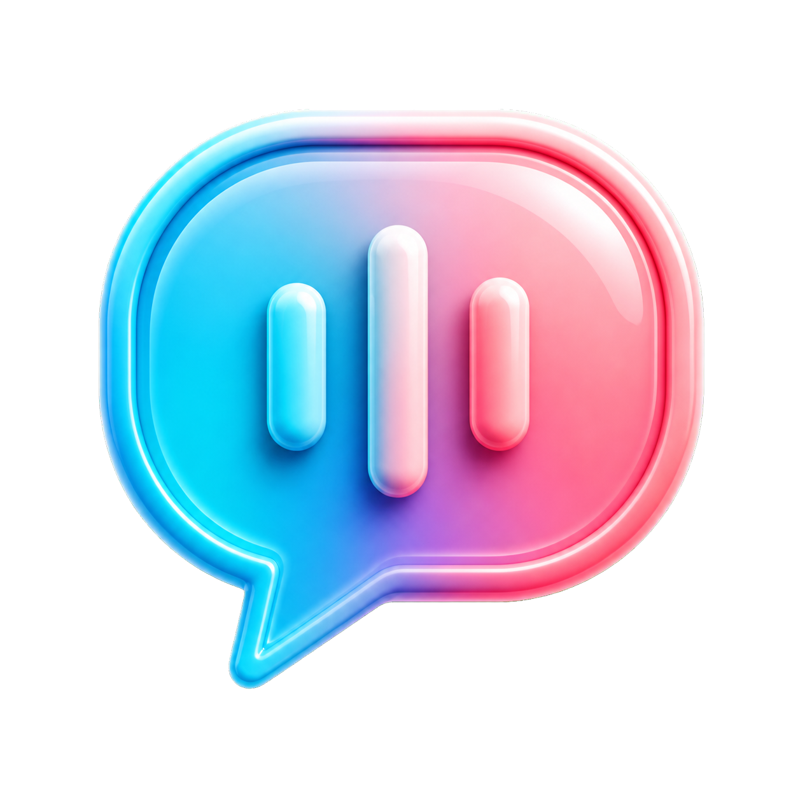

# Lector de comentarios TikTok LIVE

Aplicación moderna para Windows que muestra y lee en voz alta los comentarios de un TikTok LIVE con voces neuronales en español.



## Descargar

Descarga la versión más reciente desde [GitHub Releases](https://github.com/emanuelv793-max/lector-tiktok-live/releases/latest) y abre `LectorTikTokLive-Moderno.exe`.

> Windows puede mostrar una advertencia de SmartScreen porque el ejecutable no tiene una firma digital comercial. Comprueba que la descarga procede de este repositorio.

## Seguridad y privacidad

- Descarga la aplicación únicamente desde la página oficial de [GitHub Releases](https://github.com/emanuelv793-max/lector-tiktok-live/releases/latest).
- Cada publicación incluye una huella `SHA256SUMS.txt` para comprobar que el archivo no fue modificado. En PowerShell usa `Get-FileHash .\LectorTikTokLive-Moderno.exe -Algorithm SHA256` y compara ambos valores.
- La aplicación valida y limita los datos recibidos del LIVE, evita que una avalancha de comentarios bloquee el equipo y no ejecuta el contenido de los comentarios.
- No solicita contraseñas, cookies ni credenciales de TikTok.
- Las voces neuronales envían a Microsoft el texto que se va a leer. La voz local de Windows se usa como alternativa.
- GitHub revisa automáticamente el código y las dependencias en cada actualización. Consulta [SECURITY.md](SECURITY.md) para informar de un problema de forma privada.

## Uso

1. Abre `LectorTikTokLive-Moderno.exe`.
2. Escribe el usuario que está emitiendo (por ejemplo, `@miusuario`).
3. Pulsa **Conectar**.

No requiere iniciar sesión en TikTok. El usuario debe estar en directo y el equipo debe tener conexión a Internet.

## Controles

- **Leer nombres**: dice quién ha escrito antes de leer el comentario.
- **Voz activada**: permite silenciar o reactivar la lectura.
- **Probar voz**: reproduce una frase para comprobar la salida de audio de Windows.
- **Voz natural**: permite elegir voces neuronales de España o México. Necesita Internet; si el servicio no responde, se utiliza automáticamente la voz local de Windows.
- **Velocidad**: ajusta la rapidez de la voz de Windows.
- **Parar**: desconecta la aplicación del LIVE.

## Si la voz no se escucha en la emisión

Primero pulsa **Probar voz**. Si se oye en el ordenador pero no en el LIVE, activa
el audio del sistema/escritorio en TikTok LIVE Studio y selecciona el mismo
dispositivo de salida que utiliza Windows. El lector reproduce por la salida de
Windows; LIVE Studio debe capturar esa salida para enviarla a los espectadores.

## Nota técnica

La conexión usa [TikTokLive](https://github.com/isaackogan/TikTokLive), una API comunitaria no oficial. TikTok puede cambiar su sistema y requerir una actualización futura de la aplicación.

## Ejecutar desde el código

```powershell
python -m venv .venv
.\.venv\Scripts\python.exe -m pip install --require-hashes -r requirements.txt
.\.venv\Scripts\python.exe app.py
```

Para compilar el ejecutable:

```powershell
.\build.ps1
```
